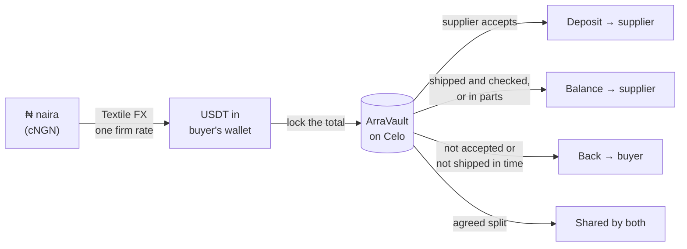
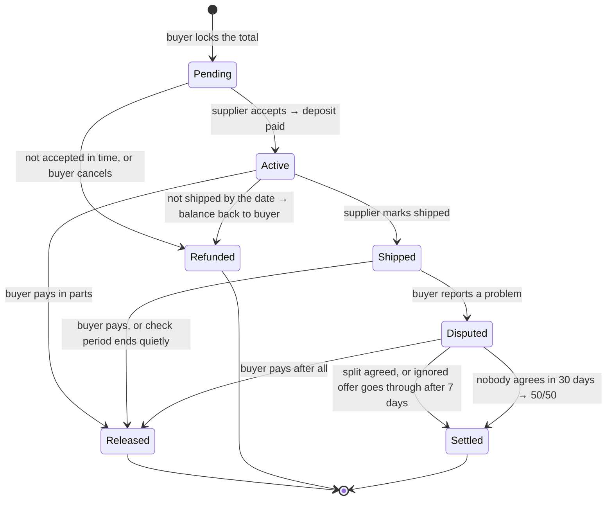
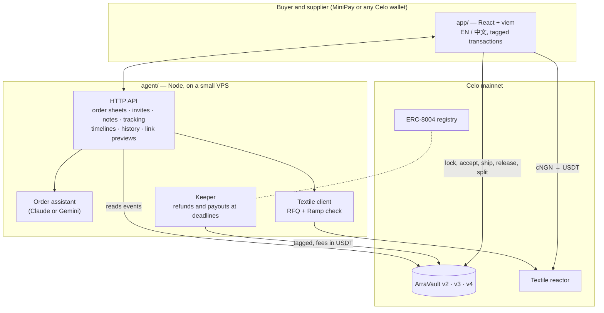

# Arra

**Pay the deposit. Keep the balance locked until it ships.**

Arra is escrow for anyone who pays a deposit now and a balance later: an importer in Lagos buying phones from Shenzhen, a family abroad paying a builder at home, a business ordering furniture or a website. The buyer locks the whole order in an open contract on Celo, paying in USDT or straight from naira at one firm rate. The supplier sees the money is really there, gets the deposit the moment they accept, and gets the balance when the goods ship or arrive. If they never accept or never ship, the money goes back to the buyer automatically. Nobody in the middle, Arra included, can take it.

- **Try it:** https://usearra.duckdns.org (Celo mainnet, real USDT; works in MiniPay and any Celo wallet)
- **Vault (v4):** [`0xa3b3…c444`](https://celoscan.io/address/0xa3b339624d21a055c6da036f8e6d219ff2c3c444) · [source verified on Sourcify](https://repo.sourcify.dev/42220/0xa3b339624d21a055c6da036f8e6d219ff2c3c444)
- **Agent:** ERC-8004 identity [#9996](https://celoscan.io/tx/0xc99e653aac82055dcefe99c1c5e7b4be6cefab39d4203a1bf73f4574a8935a90) · [agent card](agent.json) · every transaction tagged `celo_00cfddd372fa` (ERC-8021)
- **Naira in, dollars locked:** cNGN → USDT through [Textile FX](https://docs.textilecredit.com/) at one firm quote, builder codes `arra` and `celo_00cfddd372fa`

Built for [Agents on Open Rails](https://www.loops.house/agents-on-open-rails) (Celo × Loops House), **Open Corridors: Textile FX** track.


---

## Contents

[The problem](#the-problem) · [Why nothing fixes it today](#why-nothing-fixes-it-today) · [Returns](#returns-what-locking-the-rate-is-worth) · [What Arra does](#what-arra-does) · [A real order, step by step](#a-real-order-step-by-step) · [When money moves](#when-money-moves) · [Features](#features) · [Use cases](#use-cases) · [How it compares](#how-it-compares) · [Why Celo and Textile](#why-celo-and-textile) · [Potential](#potential) · [Live on mainnet](#live-on-mainnet) · [What has been verified](#what-has-been-verified) · [Trust model and limits](#trust-model-and-limits) · [Architecture](#architecture) · [Run it](#run-it) · [Roadmap](#roadmap)

---

## The problem

Nigeria buys more from China than ever: **$24.9 billion of goods in 2025, up 32% in a year**, mostly electronics, textiles, building materials and machinery ([BusinessDay, Mar 2026](https://businessday.ng/companies/article/china-nigeria-exports-reach-record-24-9bn-as-trade-gap-widens/)). Most of it is bought by small traders the same way: **30% deposit before production, 70% balance before shipping, sent by bank transfer.** Once the balance is sent, the buyer has nothing left to hold.

That is where it goes wrong:

| What happens | Real example | Source |
|---|---|---|
| **The goods never come.** | Two importers lost **₦60m** paying a naira-to-yuan middleman; the goods never arrived and the funds were frozen. | [New Telegraph, May 2025](https://newtelegraphng.com/nigerians-importing-from-china-falling-victims-to-fraud-tietie/) |
| **The goods come wrong.** | More than 50 Alaba traders pooled **₦3.3bn** for solar panels that arrived damaged; Interpol was called in. | [Blueprint, Jul 2025](https://blueprint.ng/interpol-probes-n3-3bn-fake-solar-panel-scam-from-china/) |
| **The payment is redirected.** | **$2.8bn** was lost to business email compromise in 2024 (about $8.5bn over 2022–24), much of it "our bank details have changed" messages to buyers. | [FBI IC3 via Nacha](https://www.nacha.org/news/fbis-ic3-finds-almost-85-billion-lost-business-email-compromise-last-three-years) |
| **The naira moves between deposit and balance.** | The naira went from **₦471 to ₦755 per dollar in one day** (14 June 2023) and passed ₦1,348 by January 2024. An importer who had paid the deposit suddenly needed far more naira for the balance. | [AllAfrica](https://allafrica.com/stories/202506100251.html) |
| **Disputes drag on.** | A ~$4,000 Alibaba Trade Assurance claim with fake tracking took about **a year** and still settled short. | [UK Business Forums](https://www.ukbusinessforums.co.uk/threads/alibaba-dispute-not-received.419720/post-3160396) |

And the supplier has a problem too. They ask for a deposit because they can't see whether the buyer's money exists, and they use it to buy materials. **An escrow that only protects the buyer will be refused by the supplier.** Any fix has to work for both sides.

## Why nothing fixes it today

| Tool | Why small traders can't rely on it |
|---|---|
| **Bank letter of credit** | The traditional answer, and it has collapsed for Nigeria. In 2023 foreign suppliers stopped accepting Nigerian banks' LCs and asked for cash in escrow ([BusinessDay](https://businessday.ng/business-economy/article/trouble-looms-as-foreign-suppliers-reject-letters-of-credit/)). LC payments for all of Nigeria's foreign trade were **$506m in the first nine months of 2024, down 52.5%** ([THISDAY, CBN data](https://thisdaylive.com/index.php/2025/01/13/nigerias-foreign-trade-by-lc-payments-down-52-5-yoy-to-506-1m)): a sliver next to $24.9bn of Chinese goods. |
| **Alibaba Trade Assurance** | Covers orders paid through Alibaba.com and judged on Alibaba's own chat; disputes must start within 15 days of delivery and refunds take 7–10 business days after a decision ([Alibaba seller blog](https://seller.alibaba.com/blogs/2026/southeast-asia/b2b-trade/trade-assurance-complete-guide-alibaba-secure-payment)). Deals agreed on WhatsApp or WeChat, which is most of them, are outside it. |
| **Escrow.com** | Holds everything until delivery, so the supplier gets no deposit. **Minimum fee $50** plus a $25 international wire ([Escrow.com fee calculator](https://www.escrow.com/fee-calculator)): $75 on a $500 order is 15%. |
| **Bank transfer (T/T)** | What almost everyone uses. No protection once sent, and the account number can be swapped by a scammer. |

## Returns: what locking the rate is worth

Most of an import order is paid weeks after the deposit. If the naira falls in between, the same dollar balance costs far more naira, and that comes straight out of the importer's margin. Arra converts the whole order at **one firm Textile FX rate on day one**, so the balance can't get more expensive.

A real case, with official rates:

| A $10,000 order, 30% deposit | Naira per $1 | Naira for the $7,000 balance |
|---|---|---|
| Order placed, 13 June 2023 | ₦471 ([AllAfrica](https://allafrica.com/stories/202506100251.html)) | ₦3,297,000 |
| Balance due, 31 July 2023 | ₦756.94 ([Nairametrics, FMDQ data](https://nairametrics.com/2023/08/01/end-of-july-exchange-rate-parallel-market-depreciates-by-11-5-gains-1-6-on-ie-window/)) | ₦5,298,580 |
| **Extra the importer had to find** | | **₦2,001,580 (+61%)** |
| **With Arra** (converted once, on day one) | ₦471 | **₦3,297,000, no extra** |

It isn't a one-off: the naira lost **40.9%** against the dollar over 2024 ([Nairametrics](https://nairametrics.com/2024/12/31/exchange-rate-ends-2024-at-n1535-1-marking-a-40-9-depreciation)). Rates can also move the other way, and in 2026 the naira has been firmer (about ₦1,374 per $1 in our own Textile fill). Arra doesn't bet on either direction. It removes the bet, the way a bank forward contract would, which small importers rarely get.

The cost of that certainty: Textile FX's **0.01%** fee, already in the quoted rate, plus a network fee of a fraction of a cent. Arra charges nothing today.

## What Arra does

Arra keeps the balance where both sides can see it and neither side can grab it:

- **The supplier** sees the whole order locked for them before they start, gets the deposit the instant they accept, and is paid automatically if the buyer goes quiet after the goods arrive.
- **The buyer** keeps the balance locked until shipping, can pay it in parts, gets it back automatically if deadlines pass, and can pay from naira at one rate fixed on day one.
- **Nobody in the middle** holds the money. The vault is a small, public, verified contract. Arra's agent can trigger only what the rules allow, and only ever to the buyer or the supplier.



## A real order, step by step

*Example: Tunde imports phones into Computer Village, Ikeja. His supplier is Phoenix Store in Shenzhen.*

| # | Tunde (buyer) | Phoenix Store (supplier) | The money |
|---|---|---|---|
| 1 | Opens **New order** and types: *"30 phones from Phoenix Store: 10 Samsung S10 at $10 and 20 iPhone 15 Pro at $15."* The **order assistant** fills the form and asks for what's missing: date and details. Arra refuses terms nobody could check ("good quality", "standard") and fingerprints the sheet. | | Not moved |
| 2 | Sends Phoenix Store **one link** on WhatsApp. | In one visit: reads the exact terms (in English or Chinese), connects the wallet they want to be paid in and taps **Agree**, or suggests a change. | Not moved |
| 3 | Sees "✓ Phoenix Store agreed", with the wallet's last characters to confirm on a call. Deposit 30%, shipping by sea and a 7-day check are pre-set; one tap changes them. | | Not moved |
| 4 | Pays **from naira**: Textile FX quotes one firm rate, converts cNGN into exactly the USDT needed, and Arra locks it. | Gets a link showing the full amount locked, the terms, and the deadlines. | **$400 locked** in the vault |
| 5 | | Taps **Accept** from the agreed wallet. | **$120 deposit** → supplier, instantly |
| 6 | | Makes and packs the goods, taps **Mark shipped** with the container number (Arra checks its ISO 6346 check digit, so made-up numbers are refused). | $280 still locked |
| 7 | Goods arrive. Taps **Arrived**; the check period starts. Everything's right, so he taps **Pay**. | | **$280 balance** → supplier |
| — | *Something wrong?* He taps **Something's wrong**, picks the reason, adds a photo and how much he wants back. | Accepts the offer or counters. If they ignore it for 7 days, it goes through as asked. | Held until settled |

Every step has its transaction link, a printable receipt, and a timeline both sides can see.

### The life of an order



## When money moves

| Situation | What happens | Who triggers it |
|---|---|---|
| Supplier accepts | The deposit (0–90% of the total, chosen by the buyer) goes to the supplier at once | Supplier |
| Supplier doesn't accept by the accept-by date | Everything goes back to the buyer | Anyone, normally Arra's agent |
| Buyer cancels before acceptance | Everything goes back to the buyer | Buyer |
| Not shipped by the ship-by date | The balance goes back to the buyer (the deposit was already the supplier's) | Anyone, normally the agent |
| Supplier needs more time | The buyer can move deadlines later, never earlier | Buyer |
| Goods shipped | The check period starts when the buyer confirms arrival, or after the agreed transit time (sea 60, air 14, courier 10 days) at the latest | Buyer, or the clock |
| Check period ends with no problem raised | The balance goes to the supplier | Anyone, normally the agent |
| Buyer is happy | Pays the balance, all at once or in parts | Buyer |
| Problem raised | The balance is held; either side offers a split, the other accepts | Buyer and supplier |
| A split offer is ignored for 7 days | It goes through as offered | Anyone |
| Still no agreement after 30 days | The balance is split 50/50 | Anyone |
| The agent triggers a due refund or payout | It keeps a fixed **$0.01** from that order to pay its own network fee (never when the buyer or supplier does it themselves) | Agent |

Money can only ever leave the vault to the buyer, the supplier, or that one-cent fee. The contract tests check this with thousands of random calls.

## Features

**Making the order**
- **Order assistant.** Describe the deal like a message; the assistant fills the form, works out totals for mixed items, turns "in 2 weeks" into a date, and asks one question at a time. It never handles wallet addresses. Runs on Claude or, free, on Gemini.
- **Terms agreed first, in one visit.** The buyer describes the order, then sends one link: the supplier reads the exact terms, connects their wallet and agrees (or suggests a change) before any money moves, like Escrow.com and Trade Assurance.
- **Smart defaults.** Deposit, shipping method, accept window and check period come pre-set for the kind of deal; one tap to change.
- **Clear order sheet.** Arra refuses terms nobody can check ("good quality", "standard", "same as sample", "N/A") and stores the sheet's fingerprint onchain, so neither side can change it later.
- **Three kinds of deal.** Shipped goods (the default), made to order, or a service or project: a small switch, and the wording adapts.

**Paying**
- **Pay from naira at one locked rate.** Textile FX converts cNGN into exactly the USDT the order needs, at one firm quote, in one transaction. A weaker naira next month can't touch it.
- **No CELO needed.** Network fees are paid in USDT through Celo's fee abstraction.
- **Gas for the supplier.** If the supplier's wallet is empty, the buyer can send 0.02–0.05 CELO (or $0.10 USDT for MiniPay) in the same flow, so the supplier can accept.

**Staying safe**
- **Wallet from the invite, not from a chat.** The supplier's address comes from them connecting their own wallet, so a look-alike address pasted into WhatsApp can't slip in.
- **Supplier signs to accept.** The order only goes live when the supplier signs from the payout address, proving they control it on Celo.
- **Bank-detail change alarm.** A new address for a supplier you've paid before is blocked until you confirm by phone.
- **Fake container check.** Container numbers carry a check digit; invented ones are refused.
- **Track record.** Each wallet's history on Arra (orders accepted, shipped, paid, disputed), read from the chain, shown before you lock.

**Settling**
- **Deposit on acceptance**, so suppliers have working capital and a reason to say yes.
- **Pay in parts**, like milestones: some on the bill of lading, the rest on arrival.
- **Problem report** with reason, photo and the refund you want, signed by your wallet. The supplier accepts or counters; silence doesn't freeze the money.
- **Signed notes and evidence.** Photos and agreed changes, signed by each side's wallet, so nobody can fake or edit them.
- **Automatic refunds and payouts.** Arra's agent watches every deadline and sends the transaction itself, paying its fee in USDT (refilled by its $0.01 fees) or CELO, so it never needs a manual top-up.

**Keeping records**
- Onchain **timeline**, **history** of every payment in and out (CSV download), printable **receipts**, calendar reminders, and private order links whose previews show the order in WhatsApp and Telegram.
- **Private by default.** Orders open only by their private link code, like an invoice link. "Your orders" and History need one free wallet signature, remembered on the device for 30 days, so nobody can list another wallet's orders.
- **English and Chinese** throughout the supplier's side.

## Use cases

| Who | The deal | Why Arra fits |
|---|---|---|
| **Importers** (Computer Village, Alaba, Kano, Onitsha) | Phones, solar panels, spare parts, cosmetics from China | Deposit for the factory, balance safe until shipping, naira rate locked on day one |
| **Diaspora families** | A house, a shop or a farm built at home | Release money stage by stage as photos and visits confirm the work |
| **Made-to-order buyers** | Furniture, signage, steel doors, tailoring | Maker gets money for materials; balance waits for the finished piece |
| **Businesses hiring freelancers** | Logo, website, app, marketing | Milestones without a platform holding the money |
| **Event hosts** | Caterers, decorators, DJs, venues | Deposit to book, balance after the event |
| **Online sellers and buyers** | Instagram and WhatsApp shops | A safer option than pay-on-delivery or pay-first |

## How it compares

| | **Arra** | Alibaba Trade Assurance | Escrow.com | Letter of credit | Bank transfer |
|---|---|---|---|---|---|
| Who holds the money | A public contract; nobody can move it outside its rules | Alibaba | Escrow.com | Banks | The supplier, once sent |
| Works for deals agreed on WhatsApp/WeChat | ✅ | ❌ on-platform orders | ✅ | ✅ | ✅ |
| Supplier gets a deposit | ✅ instantly on acceptance | Depends on terms | ❌ held to delivery | ❌ | ✅ unprotected |
| Proof the payee controls the address | ✅ supplier signs from it | n/a | ❌ | n/a | ❌ |
| Automatic refund if nothing ships | ✅ at the deadline | Claim | Claim | ❌ | ❌ |
| Pay in parts | ✅ any amount, any time | Limited | Milestones | ❌ | ❌ |
| Disagreements | Split offer; silence settles in 7 days, 50/50 at 30 days | Mediation | Arbitration | Document disputes | None |
| Pay from naira at a rate locked for the whole order | ✅ Textile FX | ❌ | ❌ | Rarely available to small importers | ❌ |
| Cost on a $500 order | Network fees, under a cent; $0.01 if the agent steps in | Free to buyers; card or bank fees | $50 minimum + $25 wire | Bank fees, plus access | Bank fees |

**What we learned from them (not copied):** terms agreed before money moves and evidence-based problem reports (Escrow.com, Trade Assurance); stage payments (milestone escrows); a transit allowance before inspection (letters of credit and Incoterms). What none of them do is pay the supplier on acceptance while keeping the balance out of everyone's hands.

## Why Celo and Textile

| Open rail | What Arra does with it |
|---|---|
| **Textile FX** | Keyless RFQ: the buyer signs a free ownership proof (MiniPay can too), gets a firm quote for *exactly* the USDT the order needs, and settles in one transaction. Arra converts at least $1 at a time (Textile's minimum) and keeps any change as USDT. Quotes carry builder codes. |
| **cNGN** | A regulated naira stablecoin on Celo, so "pay in naira" is a real token, not a promise. |
| **Fee abstraction** | Every fee is paid in USDT; users never need CELO. |
| **MiniPay** | The app connects automatically inside MiniPay, where Nigerian users already hold stablecoins. |
| **ERC-8004** | Arra's agent has an onchain identity (#9996) and a public agent card. |
| **ERC-8021** | Every transaction from the agent and the app carries the attribution tag `celo_00cfddd372fa`, deployments included. |
| **Cheap, fast blocks** | A full order costs a fraction of a cent, so even a $20 order is worth protecting. |

**Bank funding, next.** Textile's Ramp turns a naira bank transfer into cNGN through Busha, but today it delivers only to BNB Chain and Base, not Celo (checked live with `GET /v2/ramp/providers`). Arra's server already checks for Celo support; when it arrives, buyers can go from bank account to locked escrow in one flow.

## Potential

- **Market.** $24.9bn of Chinese goods reached Nigeria in 2025 ([BusinessDay](https://businessday.ng/companies/article/china-nigeria-exports-reach-record-24-9bn-as-trade-gap-widens/)), while letters of credit covered about $0.5bn of all foreign trade in nine months of 2024 ([THISDAY](https://thisdaylive.com/index.php/2025/01/13/nigerias-foreign-trade-by-lc-payments-down-52-5-yoy-to-506-1m)). Almost everything else moves by unprotected transfer.
- **Users already hold stablecoins.** Nigeria received over **$92bn** in crypto value from July 2024 to June 2025, first in Sub-Saharan Africa ([Chainalysis via tech.africa](https://tech.africa/sub-saharan-africa-crypto-205bn/)).
- **Beyond Nigeria.** The same deposit-and-balance problem exists on every corridor where small traders buy from China: Ghana, Kenya, Côte d'Ivoire. Each new local stablecoin on Textile is a new corridor with no change to the vault.
- **Business model (planned, not live):** a small fee on released balances for larger orders; paid add-ons such as independent inspection before release and a named arbitrator; FX volume through Textile under Arra's builder code. Arra charges nothing today.

## Live on mainnet

Everything below can be checked on Celoscan. Orders so far are **test orders placed by the team and early testers, from $0.20 to $1**, while the contract is new. The agent wallet `0xF4Fa…7053` is a team wallet, and it also placed the first naira-paid test order.

| What | Link |
|---|---|
| ArraVault v4 (new orders) | [`0xa3b339624d21a055c6da036f8e6d219ff2c3c444`](https://celoscan.io/address/0xa3b339624d21a055c6da036f8e6d219ff2c3c444) |
| v4 deployment (tagged) | [`0x0ffc45…7799`](https://celoscan.io/tx/0x0ffc4534d0e85619e0179d09b6f58f30a13a5bf18bce3464c58618b23da77799) |
| v3 paused for new orders (tagged) | [`0xe59114…73ff`](https://celoscan.io/tx/0xe591147b3ff7a99390c799778dc4ad6242cb265abdd98c05a3a89b6c2b3873ff) |
| ArraVault v3 (order #5) | [`0x5a1f66d1e8e905efb176a5f647d0b51d8a979422`](https://celoscan.io/address/0x5a1f66d1e8e905efb176a5f647d0b51d8a979422) |
| v3 deployment (tagged) | [`0x94410e…b52c`](https://celoscan.io/tx/0x94410e011e191691c0acd415872fe1fa1350d1042c403b9b2668fc1aa2c9b52c) |
| ArraVault v2 (orders #1–#4) | [`0x3da5f9d36d1ae8769a9460a7788a21c8041c7bb3`](https://celoscan.io/address/0x3da5f9d36d1ae8769a9460a7788a21c8041c7bb3) |
| v2 paused for new orders (tagged) | [`0x938747…a126`](https://celoscan.io/tx/0x93874732b99e995a6df8664c93515670079fde854117ff3df63075df7f8ba126) |
| v2 deployment (tagged) | [`0xf8d840…be86`](https://celoscan.io/tx/0xf8d8403f3574d1776a2d440e90fadbe49bb3d7706c5d49bc436a3dc3001bbe86) |
| Verified source (exact match) | v4: [Sourcify](https://repo.sourcify.dev/42220/0xa3b339624d21a055c6da036f8e6d219ff2c3c444) · v3: [Sourcify](https://repo.sourcify.dev/42220/0x5a1f66d1e8e905efb176a5f647d0b51d8a979422) · v2: [Sourcify](https://repo.sourcify.dev/42220/0x3da5f9d36d1ae8769a9460a7788a21c8041c7bb3) |
| Agent identity #9996 (tagged) | [`0xc99e65…5a90`](https://celoscan.io/tx/0xc99e653aac82055dcefe99c1c5e7b4be6cefab39d4203a1bf73f4574a8935a90) |
| Full order #3, start to finish (vault v2): $0.90 locked → supplier accepts, $0.27 deposit → $0.63 balance paid | [lock `0xfbf8a2…84f1`](https://celoscan.io/tx/0xfbf8a25ad95c4e22b7e2cd247a6d34503113fb274d05aaec028702d9183584f1) · [accept `0xb8ee68…3b7b`](https://celoscan.io/tx/0xb8ee6808c88739598968e38195e2734061412883c5b755ea3ed2f1f60c883b7b) · [pay `0xdcf0c3…2a38`](https://celoscan.io/tx/0xdcf0c35c05ef96e30f405022f3014b989a73c9b1ec697e3fdd2836d4ff802a38) |
| First Textile FX swap, 1 USDT → 1,381.23 cNGN (tagged) | [`0xd1c5fd…e906`](https://celoscan.io/tx/0xd1c5fd631c02af304388e1040e1ad9726220547ba2658740ba425c3d7063e906) |
| First naira-paid order: Textile FX fill, about ₦1,374 cNGN → 1 USDT (tagged) | [`0xc9e673…673c`](https://celoscan.io/tx/0xc9e673ac56ea2fde09f3f5c356b53ee906784491701be78955420b5c17d0673c) |
| …then locked in vault v4: $1.00 order, $0.30 deposit (tagged) | [`0xe08ff4…0622`](https://celoscan.io/tx/0xe08ff4ee88fa2d2c19eb95236c0657747cb8cecf3cec03e51f1dfa84943a0622) · [order page](https://usearra.duckdns.org/o/ek7MhbWNhw) |
| Order cap raised to $500 on vault v4 (tagged) | [`0x77a930…a8b9`](https://celoscan.io/tx/0x77a930de1c28f41726146dbbd370057f4937a26847c4caa57eed396841eba8b9) |
| Agent wallet (team) | [`0xF4Fa…7053`](https://celoscan.io/address/0xF4Fa62d294E5BcB514D27612998D7459c5D97053) |

### Vault versions: upgrading without touching anyone's money

A deployed contract can't be changed, and Arra's vault deliberately has no upgrade switch: one would let whoever holds the key swap in code that takes the funds. So an upgrade is a new vault:

| Version | What changed | Orders |
|---|---|---|
| v2 [`0x3da5…7bb3`](https://celoscan.io/address/0x3da5f9d36d1ae8769a9460a7788a21c8041c7bb3) | The original | #1–#4; finishing its open orders, no new ones |
| v3 [`0x5a1f…9422`](https://celoscan.io/address/0x5a1f66d1e8e905efb176a5f647d0b51d8a979422) | **Self-funding agent:** whoever triggers a due refund or payout gets a fixed $0.01 from that order, so the agent pays its own fees. Buyers and suppliers who do it themselves pay nothing. | #5; no new ones |
| v4 [`0xa3b3…c444`](https://celoscan.io/address/0xa3b339624d21a055c6da036f8e6d219ff2c3c444) | **Nothing can freeze or rush the money:** deadlines can only move later; the check period starts on arrival (or after transit at the latest); an ignored split offer goes through after 7 days; an unresolved dispute splits 50/50 after 30 days. | #6 onwards |

The app treats every version as one Arra: order numbers never overlap, old links keep working, and history, receipts, totals and the agent cover all vaults.

## Screens

| Supplier's page, in Chinese | Order with a split | Paying from naira |
|---|---|---|
|  |  |  |

## What has been verified

| Check | Where | Result |
|---|---|---|
| 55 contract tests: every path, deadlines, splits, keeper fee, v4 rules, plus fuzzing and invariant runs checking that the vault always holds exactly the open balances and money only leaves to the buyer, the supplier or the one-cent fee | `contracts/test/ArraVault.t.sol` (Foundry) | all pass |
| 47 agent tests: API, order sheets (vague terms, impossible dates, tiny totals), wallet sign-in, private links, invites, signed notes, tracking, track record, link previews, Textile client, keeper, order assistant | `agent/test/` | all pass |
| Mixed v3 + v4 vaults served as one Arra on a local chain | `agent/test/` with Anvil | pass |
| The real app in a browser against a local chain with the v4 vault: full order, part payments, buyer cancel, supplier decline and refund, extended deadline, problem report with split and counter-offer, terms-first invite; every balance checked to the cent | Playwright + Anvil | all match |
| Source on mainnet matches this repo exactly | Sourcify | exact match, v2, v3, v4 |
| Naira → USDT → locked order on mainnet through Textile FX | [`0xc9e673…`](https://celoscan.io/tx/0xc9e673ac56ea2fde09f3f5c356b53ee906784491701be78955420b5c17d0673c), [`0xe08ff4…`](https://celoscan.io/tx/0xe08ff4ee88fa2d2c19eb95236c0657747cb8cecf3cec03e51f1dfa84943a0622) | works |
| Attribution tag on every agent and app transaction | `npm run verify-tag` and the decoded tag on each tx | `celo_00cfddd372fa` |
| 29 real-world failure scenarios between buyers and suppliers, each traced to a fix (most shipped in v4) | our "What can go wrong" review | fixes A–J live |

## Trust model and limits

- **No admin access to money.** The owner (the agent wallet) can only pause new orders and change the per-order cap. Open orders always run to the end under their rules.
- **The agent can't redirect funds.** It can only call what is already due, and the money goes to the buyer or the supplier.
- **Defensive checks.** Fee-on-transfer tokens rejected; deposit at most 90%, so at least 10% stays locked; bounded deadlines (ship within 180 days, transit up to 120, check period 1–30 days); re-entry blocked.
- **Keys stay with their owners.** Scripts preview by default and only send with `--send`; keys live only in local `.env` files. The order assistant never sees a wallet.

**Honest limits:**
- **Not audited.** One contract, about 450 lines on OpenZeppelin building blocks, well tested, which is why each order is capped at **$500** until an outside audit.
- **No judge.** By design there's no third party; instead, silence settles (7 days for an ignored offer, 50/50 at 30 days). Orders #1–#5 on older vaults wait until both sides agree.
- **USDT can freeze wallets.** A payout to a wallet Tether has frozen would fail and the balance would wait for a refund or split.
- **Links are keys.** Amounts and wallets are public on Celo like any blockchain payment. The order sheet (product, supplier name) is private to whoever holds the order's link, so share links only with the other side. The first five orders, shared before private codes, still open by number.
- **Arra can't see the goods.** It checks container numbers and keeps signed evidence, but it can't inspect a carton. Independent inspection is on the roadmap.
- **One agent today.** If it's down, anyone (including the buyer or supplier) can call the same refund or payout themselves, for free.

## Architecture



| Path | What it is |
|---|---|
| `contracts/src/ArraVault.sol` | The vault (Solidity 0.8.28, OpenZeppelin 5) |
| `contracts/test/` | 55 Foundry tests, including fuzz and invariant runs |
| `agent/src/` | Server, keeper, vault reader for all versions, history index, Textile client, order assistant, order sheet check, invites, signed notes, link previews |
| `agent/scripts/` | Deploy, verify, register agent, Textile swap, order tools, change the order cap; all preview first |
| `app/` | The web app (landing, dashboard, new order, order page, supplier invite, history, receipts) |
| `deploy/` | One-command VPS setup (systemd, Caddy, daily backups) |
| `agent.json` | ERC-8004 agent card |

## Run it

```bash
# Contracts
cd contracts && forge test

# Agent: tests, then the server (API + app) on 127.0.0.1:8791
cd agent && npm install && npm test
cp .env.example .env     # your own keys, only if you use the scripts or keeper
npm start

# App
cd app && npm install && npm run dev      # or: npm run build

# Scripts (preview first; add --send to do it for real)
npm run check                # wallet, balances, tag
npm run deploy               # deploy a new vault version
npm run verify-vault         # publish source to Sourcify
npm run swap -- --usd 1      # Textile FX swap
npm run set-max -- 500       # change the per-order cap
```

Optional in `.env`: `KEEPER=1` (run the agent's refunds and payouts), `TEXTILE_API_KEY` (partner key), `GEMINI_API_KEY` or `ANTHROPIC_API_KEY` (order assistant). On a VPS: `bash deploy/setup.sh`.

## Roadmap

- **Bank to escrow in one flow** through Textile Ramp, as soon as it delivers cNGN on Celo.
- **Group orders:** several traders fund one container, with shares and pro-rata refunds visible to all.
- **Named arbitrator** (for example a market association leader) who can only split funds between the two parties.
- **Inspection as a release step:** an independent inspector's signed report releases the balance.
- **More corridors:** cedi, shilling and other local stablecoins on Textile.
- **Outside audit**, then a higher cap.

---

Built by [phoenix-2203](https://github.com/phoenix-2203) in Lagos.
