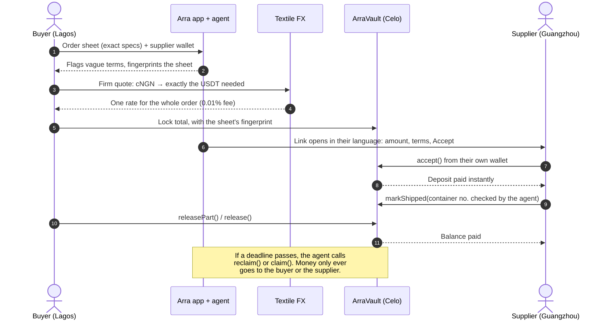
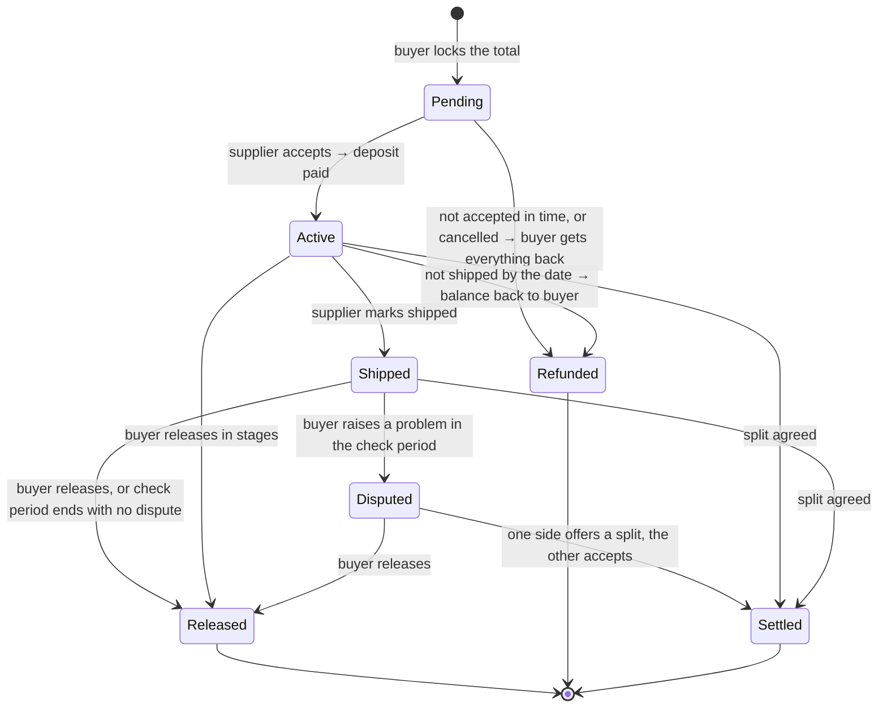
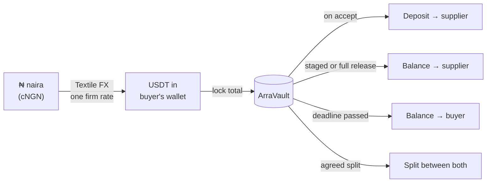
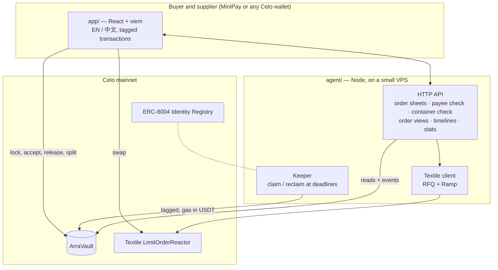

# Arra

**Pay the deposit. Keep the balance locked until it ships.**

Arra is escrow for importers buying anything from China and abroad (phones, solar panels, machine parts, clothes) and for any deal paid with a deposit and a balance. The buyer funds the order from naira or USDT at one locked rate. The supplier gets the deposit the moment they accept. The balance waits in an open contract on Celo that they can see but can't touch until the goods ship, and it comes back automatically if they don't.

**Live app:** https://usearra.duckdns.org &nbsp;·&nbsp; **Vault:** [`0x3da5…7bb3` on Celoscan](https://celoscan.io/address/0x3da5f9d36d1ae8769a9460a7788a21c8041c7bb3) &nbsp;·&nbsp; **Source:** [verified on Sourcify](https://repo.sourcify.dev/42220/0x3da5f9d36d1ae8769a9460a7788a21c8041c7bb3) &nbsp;·&nbsp; **Agent:** ERC-8004 #9996

Built for the [Agents on Open Rails](https://www.loops.house/agents-on-open-rails) hackathon (Celo × Loops House), **Open Corridors: Textile FX** track.


---

## The problem

Nigerian importers usually pay a Chinese supplier a 30% deposit before production and the 70% balance before shipping. The deposit is the easy part. The balance is where it goes wrong, and the tools that should protect it have stopped working for small traders.

| What happened | Source |
|---|---|
| In 2023 foreign suppliers stopped accepting Nigerian banks' letters of credit and asked for **cash in escrow** instead; the central bank had about $3bn of unpaid FX forwards. | [BusinessDay, Sep 2023](https://businessday.ng/business-economy/article/trouble-looms-as-foreign-suppliers-reject-letters-of-credit/) |
| **$2.8bn** was lost to business email compromise in 2024 (nearly $8.5bn over 2022–24), much of it "our bank details have changed" messages to buyers. | [FBI IC3, via Nacha](https://www.nacha.org/news/fbis-ic3-finds-almost-85-billion-lost-business-email-compromise-last-three-years) |
| The naira went from **₦471 to ₦755 per dollar in one day** (14 June 2023) and passed ₦1,348 by January 2024. An importer who had paid a deposit needed far more naira for the balance. | [AllAfrica](https://allafrica.com/stories/202506100251.html) |
| Two importers lost **₦60m** paying a naira-to-yuan middleman; the goods never came and the funds were frozen. | [New Telegraph, May 2025](https://newtelegraphng.com/nigerians-importing-from-china-falling-victims-to-fraud-tietie/) |
| A ~$4,000 Alibaba Trade Assurance claim with fake tracking took about **a year** and still settled short. | [UK Business Forums](https://www.ukbusinessforums.co.uk/threads/alibaba-dispute-not-received.419720/post-3160396) |
| Over 50 Alaba traders pooled **₦3.3bn** for solar panels that arrived damaged. | [Blueprint, Jul 2025](https://blueprint.ng/interpol-probes-n3-3bn-fake-solar-panel-scam-from-china/) |

Suppliers aren't the villains here either: they ask for deposits because they can't see the buyer's money, and they treat the deposit as working capital. **An escrow that only protects the buyer won't be accepted.**

## The solution

Arra gives both sides what they actually need:

- **The supplier** sees the full amount locked for them before they start, gets the deposit the instant they accept, and is paid automatically if the buyer goes quiet after shipping.
- **The buyer** keeps the balance locked until shipping, can release it in stages, gets it back automatically if deadlines pass, and pays from naira at one rate fixed on day one.
- **Nobody in the middle** holds the money. The vault is a public, verified contract. Arra itself can't move locked funds.

## How it works



### The life of an order



### Where the money goes



## What makes Arra different

| | **Arra** | Alibaba Trade Assurance | Escrow.com | Bank letter of credit | Bank transfer (T/T) |
|---|---|---|---|---|---|
| Who holds the money | Public contract; nobody can move it outside its rules | Alibaba | Escrow.com | Banks | The supplier, as soon as it's sent |
| Supplier gets deposit before shipping | ✅ instantly, on acceptance | Depends on agreement | ❌ held until delivery | ❌ | ✅ (no protection) |
| Proof the payee controls the address | ✅ supplier must sign from it | ❌ | ❌ | n/a | ❌ ("bank details changed" scams) |
| Settling a disagreement | One-tap split, seconds | Mediation, reportedly weeks | Arbitration | Document disputes | None |
| Release in stages | ✅ any amount, any time | Limited | Milestones | ❌ | ❌ |
| Pay from naira at a rate locked for the whole order | ✅ Textile FX | ❌ | ❌ | Often unavailable to small importers | ❌ |
| Works for $20 orders | ✅ fees are fractions of a cent | ✅ | Fees outweigh small orders | ❌ | ✅ |
| Automatic refund if nothing ships | ✅ agent-triggered at the deadline | Claim process | Claim process | ❌ | ❌ |

## Special features

Each one answers a documented way these deals fail.

1. **Supplier signs to accept (F1).** The order only goes live when the supplier signs from the exact payout address. That proves they control it and that it works on Celo, which stops redirected payments and wrong-network losses before any money moves. Until then the buyer can cancel and get everything back.
2. **Deposit paid on acceptance (F2).** Suppliers get working capital immediately, which is why they'll agree to use Arra.
3. **One-tap split (F3).** Either side proposes a split (say 80/20); the other accepts and it settles in one transaction. No arbitrator, no fee, no 40-day wait.
4. **Staged release (F4).** Release any part of the balance at any time, like milestones: some when the bill of lading arrives, the rest on delivery.
5. **Supplier protection (F5).** If the goods are marked shipped and the buyer doesn't raise a problem within the agreed check period, the supplier is paid automatically.
6. **Automatic refunds (F6).** Not accepted by the accept-by date, or not shipped by the ship-by date: the money goes back to the buyer. Arra's agent sends the transaction itself.
7. **Fingerprinted order sheet (F7).** Arra flags unmeasurable terms ("good quality", "same as sample") and stores the sheet's keccak256 fingerprint onchain as the order's reference, so neither side can change the terms later.
8. **Fake shipment check (F8).** Container numbers (ISO 6346) carry a check digit; a made-up one is rejected instantly.
9. **Bank-detail change alarm (F9).** Arra remembers each supplier's address. A new one for a known supplier is blocked until the buyer confirms by phone.
10. **Bilingual supplier page (F10).** The supplier's link opens in English or Simplified Chinese (the buyer picks, or it follows the supplier's phone language) with the locked amount, the terms and an Accept button.
11. **Rate locked on day one (F11).** Pay from naira: Textile FX converts cNGN into exactly the USDT the order needs at one firm rate, so a weaker naira next month can't hurt.
12. **Onchain timeline, history and receipts.** Every step (locked, accepted, shipped, released) is read from the vault's events with its time and transaction link. A History page lists every payment in and out of your wallet (downloadable as CSV), and every order has a printable receipt with each payment and its transaction link.
13. **No gas, no problem.** A supplier with an empty wallet can't pay the network fee to accept. Arra checks the supplier's wallet while the order is being made, and the buyer can send 0.02 or 0.05 CELO (or $0.10 USDT for MiniPay and Valora) along with the order, in the same flow. If they skipped it, the order page offers the same one-tap top-up.

## Not just imports

The same contract protects any deal with a deposit and a balance. When creating an order the buyer picks **goods shipped**, **made to order**, or **a service or project**, and the wording and required fields adapt (for example "Mark as delivered" instead of a container number). The deal type is part of the fingerprinted sheet.

- **Diaspora projects at home:** fund a build or business and release money stage by stage as work is done.
- **Made-to-order:** furniture, signage, fabrication, custom outfits.
- **Events:** caterers, decorators, DJs, venues.
- **Freelance and agency work:** milestones without a platform holding the money.
- **Online vendors:** a safer alternative to pay-on-delivery.

## Built on Celo's open rails

| Rail | How Arra uses it |
|---|---|
| **Textile FX** | Keyless RFQ: the buyer signs a free TakerControl proof, gets a firm cNGN→USDT quote for exactly the USDT needed (exact output), and settles in one transaction. Quotes carry builder codes. Naira bank top-up via the Ramp API where available. |
| **ERC-8004** | Arra's agent is registered in the Identity Registry as **#9996**, with its [agent card](agent.json) in this repo. |
| **ERC-8021** | Every transaction the agent and the app send carries the attribution tag `celo_00cfddd372fa`, including contract deployment (the SDK doesn't wrap deploys, so Arra routes them through the tagged sender). |
| **Fee abstraction** | Fees are paid in USDT via the fee-currency adapter; no CELO needed. |
| **MiniPay** | The app connects automatically inside MiniPay and goes straight to the user's orders. |

## Live on Celo mainnet

| What | Link |
|---|---|
| ArraVault | [`0x3da5f9d36d1ae8769a9460a7788a21c8041c7bb3`](https://celoscan.io/address/0x3da5f9d36d1ae8769a9460a7788a21c8041c7bb3) |
| Vault deployment (tagged) | [`0xf8d840…be86`](https://celoscan.io/tx/0xf8d8403f3574d1776a2d440e90fadbe49bb3d7706c5d49bc436a3dc3001bbe86) |
| Verified source (exact match) | [Sourcify](https://repo.sourcify.dev/42220/0x3da5f9d36d1ae8769a9460a7788a21c8041c7bb3) · [Blockscout](https://celo.blockscout.com/address/0x3da5f9d36d1ae8769a9460a7788a21c8041c7bb3?tab=contract) |
| Agent identity #9996 (tagged) | [`0xc99e65…5a90`](https://celoscan.io/tx/0xc99e653aac82055dcefe99c1c5e7b4be6cefab39d4203a1bf73f4574a8935a90) |
| First Textile FX swap, 1 USDT → 1,381.23 cNGN (tagged) | [`0xd1c5fd…e906`](https://celoscan.io/tx/0xd1c5fd631c02af304388e1040e1ad9726220547ba2658740ba425c3d7063e906) |
| Agent wallet | [`0xF4Fa…7053`](https://celoscan.io/address/0xF4Fa62d294E5BcB514D27612998D7459c5D97053) |

## Screens

| Supplier's page, in Chinese | Buyer settling with a split | Paying from naira |
|---|---|---|
|  |  |  |

## Architecture



```
contracts/   ArraVault.sol (Solidity 0.8.28, OpenZeppelin 5) + Foundry tests
agent/       server, keeper, Textile client, order sheet, payee book, container check, scripts
app/         React app (homepage, dashboard, new order, order page)
deploy/      one-command VPS setup (systemd + Caddy)
agent.json   ERC-8004 agent card
```

## Safety

- **No admin access to money.** The owner can only pause new orders and change the per-order cap. Existing orders always run to completion.
- **Every exit is to the buyer or the supplier.** 34 contract tests, including fuzzing and invariant runs (thousands of random calls) checking that the vault always holds exactly the sum of open balances and that money never goes anywhere else.
- **Defensive checks.** Fee-on-transfer tokens are rejected, deposits are capped at 90% so at least 10% always stays locked, deadlines are bounded (ship within 180 days, check period 1–30 days), and re-entry is blocked.
- **Small by design while new.** Orders are capped at $50 each during the pilot.
- **Keys stay with their owners.** Scripts preview by default and only send with `--send`; private keys live only in local `.env` files.

## Run it

```bash
# Contracts
cd contracts && forge test

# Agent: tests, then the server (API + app) on 127.0.0.1:8791
cd agent && npm install && npm test
cp .env.example .env        # add your own key only if you use the scripts or keeper
npm start

# App
cd app && npm install && npm run dev     # or: npm run build

# Scripts (preview first; add --send to do it for real)
npm run check               # wallet, balances, tag
npm run register            # ERC-8004 identity
npm run deploy              # deploy ArraVault
npm run verify-vault        # publish source to Sourcify (and Celoscan with a key)
npm run swap -- --usd 1     # Textile FX swap
```

Server setup on a VPS: `bash deploy/setup.sh` (installs, builds and runs Arra as a service, then prints the Caddy block).

## Roadmap

- Group orders: several traders fund one container, with shares and pro-rata refunds visible to all.
- Optional named arbitrator (for example a market association leader) who can only split funds between the two parties.
- Paid tracking lookups and inspector approval as a release step.
- Raising the per-order cap as the contract builds a track record.

---

Built by [phoenix-2203](https://github.com/phoenix-2203) in Lagos.
